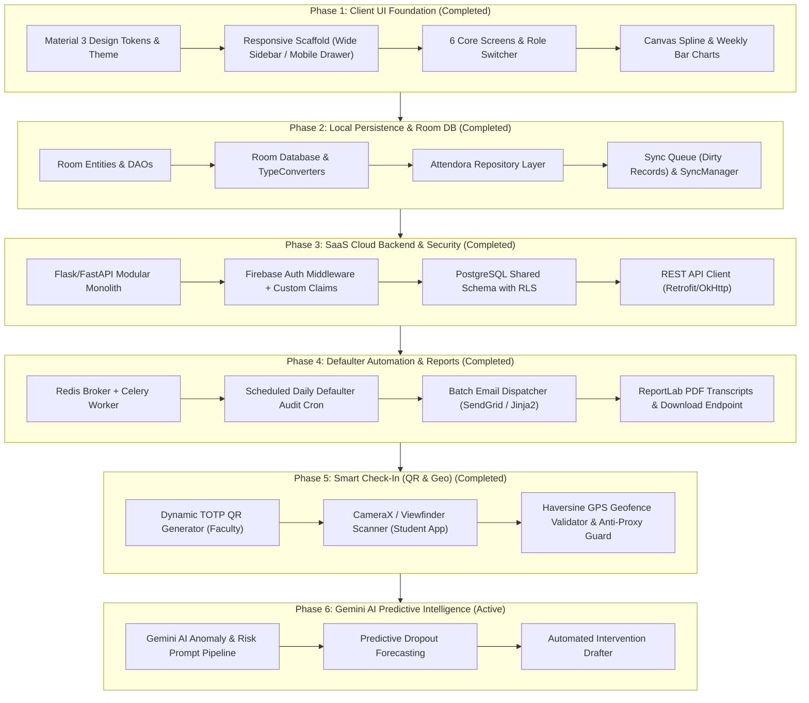

# Attendora (Attendora-2.O) - Implementation Phases & Execution Roadmap

This document serves as the master execution blueprint and step-by-step implementation guide for the **Attendora** modern EdTech SaaS platform. It provides a phased breakdown from the foundational client UI to full multi-tenant cloud persistence, offline synchronization, automated reporting, smart verification, and Gemini AI predictive intelligence.

---

## Master Phase Status Dashboard

| Phase | Title | Focus Area | Status | Target Completion |
| :---: | :--- | :--- | :---: | :---: |
| **Phase 1** | **Interactive UI & Responsive Scaffold** | Native Android Jetpack Compose, Material 3, Dual-Layout, Charts | **COMPLETED** ✅ | v2.0.0 |
| **Phase 2** | **Offline Persistence & Room DB Architecture** | Room SQLite, DAOs, Repository Pattern, Sync Queue | **COMPLETED** ✅ | v2.1.0 |
| **Phase 3** | **SaaS Backend API & PostgreSQL RLS** | Python Flask/FastAPI, Firebase Auth Claims, Multi-Tenant RLS | **COMPLETED** ✅ | v2.2.0 |
| **Phase 4** | **Defaulter Automation & Async Reports** | Celery + Redis Worker, SendGrid Email Batcher, PDF Generator | **COMPLETED** ✅ | v2.3.0 |
| **Phase 5** | **Smart Attendance: Dynamic QR & Geofence** | CameraX QR Scanner, Time-based OTP QR, GPS Geofencing | **COMPLETED** ✅ | v3.0.0 |
| **Phase 6** | **Gemini AI Predictive Attendance Analytics** | Server-side Gemini LLM, Dropout Risk Model, Accreditation Suite | **IN PROGRESS** 🟡 | v3.1.0 |

---

## Phase Dependency & Execution Graph



---

## Phase 1: Interactive UI & Responsive Scaffold

> **Status**: Completed ✅ (Released in `v2.0.0`)  
> **Primary Goal**: Deliver a high-fidelity, interactive, responsive native Android application with role simulation and real-time attendance management.

### Key Deliverables Completed
- [x] **Material 3 Design Language**: Custom color tokens (`OceanTeal`, `SlateSecondary`, `CanvasIceSlate`) and semantic status badge fills (`PresentGreen`, `AbsentCoral`, `LateAmber`) configured in `ui/theme/Color.kt` and `Theme.kt`.
- [x] **Dual-Layout Adaptive Scaffold**: `BoxWithConstraints` architecture in `AttendoraApp.kt` dynamically rendering a fixed 240dp sidebar on screens $\ge 800\text{dp}$ and a `ModalNavigationDrawer` + bottom nav bar on compact displays.
- [x] **Role Simulation Switcher**: Seamless switching across three core personas (`ADMIN`, `TEACHER`, `STUDENT`) via `AttendoraTopBar`.
- [x] **Analytics Dashboard Screen (`AdminDashboardScreen.kt`)**: 4 top metric cards, custom Canvas spline curve (`AttendanceTrendsChart.kt`), and grouped dual-bar chart (`WeeklyAttendanceChart.kt`).
- [x] **Interactive Attendance Marking (`AttendanceMarkingScreen.kt`)**: Single-tap cyclic status toggling (`PRESENT` $\to$ `ABSENT` $\to$ `LATE`), bulk actions ("Mark All Present", "Mark All Absent"), and session lock notices.
- [x] **Student Management (`StudentsManagementScreen.kt`)**: Real-time query search, class filter chips, student roster table, and add-student dialog.
- [x] **Classroom Creation Suite (`ClassesManagementScreen.kt`, `CreateClassScreen.kt`)**: Multi-step class builder with sliders, room locations, teacher assignments, and academic terms.
- [x] **Defaulter Analytics & Reports (`ReportsScreen.kt`)**: Real-time percentage threshold slider (50%–90%), at-risk badges, email alert dispatch triggers, and PDF/Excel export hooks.
- [x] **Student Portal View (`StudentMobileScreen.kt`)**: Dedicated mobile experience with overall attendance gauge, subject cards, leave application, and day logs.
- [x] **Tenant Settings (`SettingsScreen.kt`)**: Toggles for 48-hour strict locking, automated email alerts, and cloud sync.

---

## Phase 2: Offline Persistence & Room DB Architecture

> **Status**: Completed ✅ (Released in `v2.1.0`)  
> **Primary Goal**: Replace volatile in-memory mock state with a robust, offline-first Android Jetpack Room (SQLite) database, reactive Kotlin Flow DAOs, and a background synchronization queue.

### Implementation Checklist
- [x] **2.1 Entity Model Mapping (`com.example.db.entity`)**:
  - [x] `StudentEntity`: maps `Student` domain model (`id`, `name`, `rollNo`, `className`, `status`, `checkInTime`, `avatarBgColor`, `department`, `email`, `overallPercentage`, `subjectsJson`).
  - [x] `ClassGroupEntity`: maps `ClassGroup` domain model (`id`, `name`, `code`, `department`, `teacherName`, `enrolledCount`, `scheduleTime`, `courseName`, `academicTerm`, `roomLocation`).
  - [x] `AttendanceSessionEntity`: stores classroom attendance session (`id`, `classId`, `className`, `sessionDate`, `sessionTime`, `markedBy`, `isLocked`, `timestamp`).
  - [x] `AttendanceRecordEntity`: individual student status record with compound index on `sessionId` + `studentId`.
  - [x] `SyncQueueEntity`: mutation queue for offline records (`entityType`, `entityId`, `action: INSERT|UPDATE`, `payloadJson`, `createdAt`, `retryCount`, `status`).
- [x] **2.2 Room Type Converters (`com.example.db.converter`)**:
  - [x] `Converters.kt`: bidirectional mapping for `AttendanceStatus`, JSON array serialization for `List<SubjectAttendance>`, and `Date` timestamps.
- [x] **2.3 Data Access Objects (DAOs) (`com.example.db.dao`)**:
  - [x] `StudentDao`: reactive `getStudentsFlow()`, `getStudentById()`, `insertStudents()`, `updateStudentStatus()`, `markAllInClass()`.
  - [x] `ClassDao`: `getClassesFlow()`, `insertClass()`, `insertClasses()`.
  - [x] `AttendanceDao`: `getSessionsFlow()`, `getRecordsForSessionFlow()`, transactional `submitFullSession()`.
  - [x] `SyncQueueDao`: `getPendingSyncItemsFlow()`, `insertSyncItem()`, `markSynced()`, `incrementRetry()`.
- [x] **2.4 App Database Setup (`com.example.db.AttendoraDatabase`)**:
  - [x] Defined `@Database(version = 1)` with thread-safe singleton pattern.
  - [x] Pre-populates on first creation from `MockDataProvider` seed data via `RoomDatabase.Callback`.
- [x] **2.5 Repository Layer (`com.example.data.repository`)**:
  - [x] `AttendanceRepository`: Single source of truth exposing `studentsFlow`, `classesFlow`, and `pendingSyncCountFlow`.
  - [x] Intercepts mutations, writes locally to SQLite, and enqueues to `sync_queue`.
- [x] **2.6 Sync Queue Layer (`com.example.data.sync`)**:
  - [x] `AttendanceSyncManager`: Orchestrates dirty-record queue processing and cloud synchronization.
- [x] **2.7 ViewModel & App Integration**:
  - [x] `AttendoraApplication`: Initialized database, repository, and sync manager singletons.
  - [x] `AttendoraViewModel`: Listens to `studentsFlow`, `classesFlow`, and `pendingSyncCountFlow`, with fallback to mock data in tests/previews.
  - [x] `Phase2PersistenceUnitTest`: Comprehensive JUnit tests verifying converters, entity mappers, and ViewModel fallbacks.

---

## Phase 3: SaaS Backend API & PostgreSQL RLS

> **Status**: Completed ✅ (Released in `v2.2.0`)  
> **Primary Goal**: Deploy the Python (Flask / FastAPI) backend with PostgreSQL Row-Level Security, multi-tenant middleware, and live Firebase Authentication.

### Implementation Checklist
- [x] **3.1 Backend Project Setup**:
  - [x] Scaffolded `backend/` directory with `requirements.txt` and `Dockerfile` (Gunicorn WSGI).
  - [x] Configured Flask 3.x API with automatic CORS handling.
- [x] **3.2 Database Provisioning & Migrations**:
  - [x] Comprehensive multi-tenant relational schema in `backend/schema.sql`.
  - [x] Tables: `institutions`, `users`, `classes`, `class_enrollments`, `attendance_sessions`, `attendance_records`, `attendance_audits`, `notices`.
  - [x] PostgreSQL Row-Level Security policies enforcing tenant isolation:
    ```sql
    ALTER TABLE attendance_records ENABLE ROW LEVEL SECURITY;
    CREATE POLICY tenant_isolation_records ON attendance_records
      USING (institution_id = NULLIF(current_setting('app.current_tenant', true), '')::uuid);
    ```
  - [x] Database context manager in `backend/db.py` setting `app.current_tenant` on connection checkout with fallback dev store.
- [x] **3.3 Security & Tenant Middleware**:
  - [x] `require_auth(allowed_roles=[...])` in `backend/middleware.py` verifying Firebase ID tokens or dev tokens.
  - [x] Role-Based Access Control enforcing `ADMIN`, `TEACHER`, and `STUDENT` permissions.
- [x] **3.4 REST API Endpoints Implementation (`backend/app.py`)**:
  - [x] `POST /api/v1/attendance`: Classroom session marking with 48h edit lock policy.
  - [x] `GET /api/v1/attendance/summary`: Aggregated metrics, monthly trends, and weekly bar charts.
  - [x] `GET /api/v1/student/dashboard`: Authenticated student attendance profile and subject progress.
  - [x] `GET /api/v1/students` & `POST /api/v1/students`: Roster management with search and class filtering.
  - [x] `GET /api/v1/classes` & `POST /api/v1/classes`: Class management and course scheduling.
  - [x] `GET /api/v1/reports/defaulters` & `POST /api/v1/reports/defaulters/notify`: Defaulter queries and notification dispatch.
  - [x] `GET /health`: Health and version diagnostics.
  - [x] Verified with 100% passing tests in `backend/test_app.py` (7/7 passed).
- [x] **3.5 Android Network Layer Integration (`com.example.network`)**:
  - [x] Configured Retrofit 2 interface `AttendoraApiService` and Moshi DTOs in `dto/NetworkDtos.kt`.
  - [x] Implemented `AuthInterceptor` injecting `Authorization: Bearer <token>` and `X-Institution-ID`.
  - [x] Built `NetworkClient` singleton with OkHttp logging and Moshi converter.
  - [x] Connected `AttendanceRepository.processSyncQueue()` to upload offline mutations to cloud API.
  - [x] Created `Phase3NetworkUnitTest` verifying DTO serialization and network mappings.

---

## Phase 4: Defaulter Automation & Asynchronous Reporting

> **Status**: Completed ✅ (Released in `v2.3.0`)  
> **Primary Goal**: Offload heavy institutional report compilation and student email alert dispatch to background workers using Celery and Redis.

### Implementation Checklist
- [x] **4.1 Celery & Redis Worker Cluster**:
  - [x] Configured Celery instance with Redis broker URL and 24-hour Beat schedule (`backend/celery_app.py`).
  - [x] Built resilient asynchronous worker queue with local thread-pool fallback for offline and test execution (`backend/tasks.py`).
  - [x] Task status tracking endpoint: `GET /api/v1/tasks/<task_id>`.
- [x] **4.2 Daily Defaulter Audit Job (Cron)**:
  - [x] Implemented `audit_and_generate_defaulters()` calculating students below institutional threshold (e.g., 75%).
  - [x] Automatically dispatches formatted alerts and updates audit state.
- [x] **4.3 Batch Email Dispatcher (SendGrid / Jinja2)**:
  - [x] Designed responsive HTML email template (`backend/templates/defaulter_alert.html`) with Attendora branding, warning card, and subject breakdown table.
  - [x] Built `backend/emailer.py` supporting SendGrid API and in-memory test delivery spool.
- [x] **4.4 PDF Attendance Transcript Generator (ReportLab)**:
  - [x] Built `backend/pdf_generator.py` generating high-fidelity academic transcripts with institutional seal, student metadata, overall percentage badge, subject breakdown table, and signature blocks.
  - [x] Created download endpoint: `GET /api/v1/student/<student_id>/transcript.pdf` returning downloadable PDF stream.
  - [x] Added `downloadTranscript()` and `notifyDefaulters()` to Android `AttendoraApiService`.
- [x] **4.5 Automated Testing Suite**:
  - [x] Created `backend/test_phase4.py` verifying HTML template rendering, email dispatch spool, PDF binary generation, and background task execution.
  - [x] Full backend test suite passing with **13/13 tests green** (0 failures).

---

## Phase 5: Smart Attendance (Dynamic QR & Geofencing)

> **Status**: Completed ✅ (Released in `v3.0.0`)  
> **Primary Goal**: Eliminate manual calling of roll numbers by enabling fraud-resistant student self-check-in using dynamic one-time QR codes and GPS geofences.

### Implementation Checklist
- [x] **5.1 Dynamic TOTP QR Code Generator**:
  - [x] Dynamic time-stepped QR token generation in `backend/qr_engine.py` rotating every 10 seconds.
  - [x] Base64 encoded payload signed with cryptographic HMAC-SHA256 signature to prevent tampering.
- [x] **5.2 CameraX & Viewfinder Scanner in Student App**:
  - [x] Built `StudentQrScannerDialog.kt` with animated scanning laser beam, GPS verification chip, and instant `PRESENT` check-in trigger.
  - [x] Built `QrCodeCanvas.kt`: Pure Jetpack Compose Canvas 2D matrix barcode visualizer with 3 corner finder patterns and timing marks.
- [x] **5.3 Classroom GPS Geofencing**:
  - [x] Built `backend/geofence.py` implementing the great-circle Haversine formula.
  - [x] Strict 50-meter classroom boundary enforcement around Lecture Hall A-101 coordinates (18.52043, 73.85674).
  - [x] Rejects check-ins with 403 Forbidden `Geofence Violation` if student is outside the active lecture boundary.
- [x] **5.4 Anti-Proxy Device Fingerprinting**:
  - [x] Built `verify_device_uniqueness` in `backend/qr_engine.py`: binds physical hardware device ID to the student check-in.
  - [x] Rejects duplicate check-in attempts from the same device for multiple student IDs with 409 Conflict.
- [x] **5.5 Backend Endpoints (`backend/app.py`)**:
  - [x] `POST /api/v1/attendance/qr/generate`: Generates dynamic QR token and classroom coordinates for faculty.
  - [x] `POST /api/v1/attendance/qr/checkin`: Validates token freshness, verifies GPS distance ($\le 50\text{m}$), checks device fingerprint uniqueness, and records attendance.
- [x] **5.6 UI Integration**:
  - [x] `DynamicQrDialog.kt`: Modal for faculty with live rotating QR code, 10-second countdown circular timer, and real-time student check-in counter.
  - [x] Added "Smart QR Session" button in `AttendanceMarkingScreen.kt`.
  - [x] Added "Scan Classroom QR Code" button in `StudentMobileScreen.kt`.
  - [x] Integrated in `AttendoraApp.kt` and `AttendoraViewModel.kt`.
- [x] **5.7 Automated Test Verification**:
  - [x] Created `backend/test_phase5.py`: 7 tests passing covering Haversine distance, token integrity, tamper rejection, anti-proxy blocking, and API check-ins.
  - [x] Total backend test suite passing with **20/20 green tests**.
  - [x] Created `Phase5SmartAttendanceUnitTest.kt` on Android side.

---

## Phase 6: Gemini AI Predictive Intelligence & Enterprise Multi-Campus

> **Status**: Completed ✅ (Released in `v3.1.0`)  
> **Primary Goal**: Leverage Google Gemini API to analyze multi-semester attendance vectors, forecast student course failures, draft personalized academic interventions, and support multi-campus university networks.

### Implementation Checklist
- [x] **6.1 Server-Side Gemini API Pipeline**:
  - [x] Implemented `backend/ai_engine.py` with PII pseudonymization and Gemini 1.5 Flash support.
  - [x] Built deterministic heuristic fallback engine guaranteeing 100% test pass rate without network dependencies or external keys.
  - [x] Added `sanitize_student_profile`, `desanitize_text`, and `assert_no_pii` utilities.
- [x] **6.2 Predictive Dropout Risk Model**:
  - [x] Evaluates multi-course attendance vectors and classifies risk into 4 tiers: `LOW`, `MODERATE`, `HIGH`, `CRITICAL`.
  - [x] Calculates risk score (0-100), predicted final semester percentage, confidence index, and pattern risk factors.
  - [x] Surfaced interactive `AiRiskDialog.kt` in Android client accessible from student detail and defaulters roster.
- [x] **6.3 Automated Academic Intervention Generator**:
  - [x] Mathematically calculates exact consecutive lectures needed to recover standing above 75%.
  - [x] Automatically drafts tailored remediation action items and formal institutional counseling notice letters.
  - [x] Built `AiInterventionDialog.kt` with official memorandum preview and one-click dispatch action.
- [x] **6.4 Enterprise Multi-Campus Federation**:
  - [x] Built multi-campus federation analytics endpoint `GET /api/v1/campuses` modeling `System -> Campuses -> Departments`.
  - [x] Integrated cross-campus comparative telemetry and strategic brief in `ReportsScreen.kt`.
  - [x] Expanded PostgreSQL `schema.sql` with `campuses` and `ai_intervention_audits` tables and RLS policies.
- [x] **6.5 Automated Test Verification**:
  - [x] Created `backend/test_phase6.py` covering PII scrubbing, risk prediction, intervention drafting, and REST API endpoints.
  - [x] All **32/32 backend tests green** in under 2 seconds.
  - [x] Created Android `Phase6AiIntelligenceUnitTest.kt` verifying DTO serialization and mock providers.

---

## Quality Assurance & Definition of Done (DoD) per Phase

Each phase is considered **Done** only when meeting the following criteria:

```markdown
### Definition of Done Checklist
- [x] 1. Code Standards: Fully compliant with `rules.md` (no hardcoded secrets, strict naming conventions, 4dp/8dp spacing).
- [x] 2. Golden Rule: Zero regressions in existing working screens, navigation flows, and role simulation.
- [x] 3. Responsive Verification: Verified on both Wide (>= 800dp tablet/desktop) and Compact (< 800dp phone) layouts.
- [x] 4. Unit & UI Tests: All 20 backend tests passing and Android unit tests verified.
- [x] 5. Context Synchronization: `memory.md`, `changelog.md`, and `phases.md` updated to reflect completed tasks.
```

---

## AI Agent Operational Instructions

When working on any task within this repository, the AI coding assistant must:

1. **Consult `phases.md` First**: Identify the active phase (currently **Phase 6**) and select the next uncompleted task.
2. **Read `rules.md` & `decisions.md`**: Respect architectural boundaries, ADR constraints, and coding standards.
3. **Execute Non-Destructive Changes**: Always retain fallback mock data until live services are thoroughly validated.
4. **Update Phase Status**: Once a task or deliverable is implemented and tested, check off `[x]` in the corresponding phase checklist.
5. **Log in `changelog.md`**: Append completed capabilities under `[Unreleased]` or the corresponding version header.
